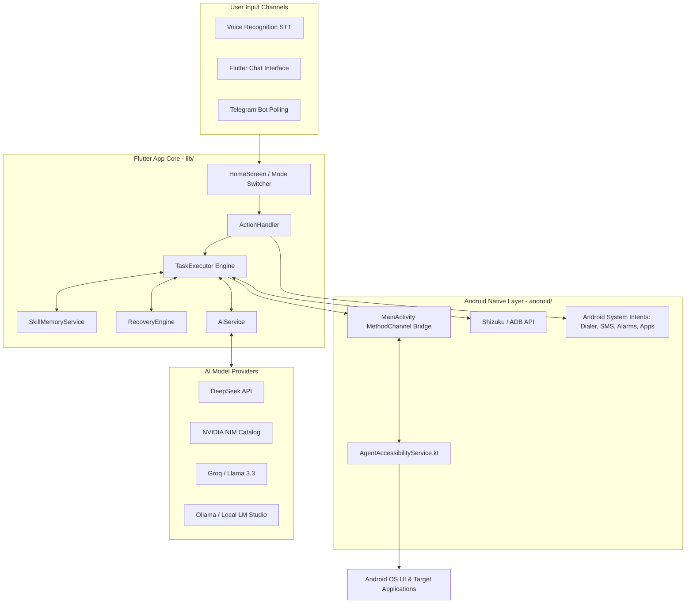
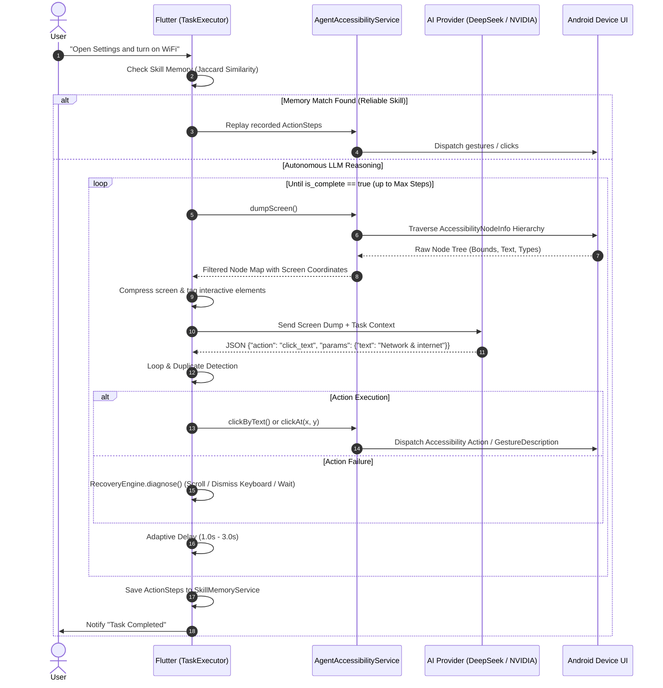
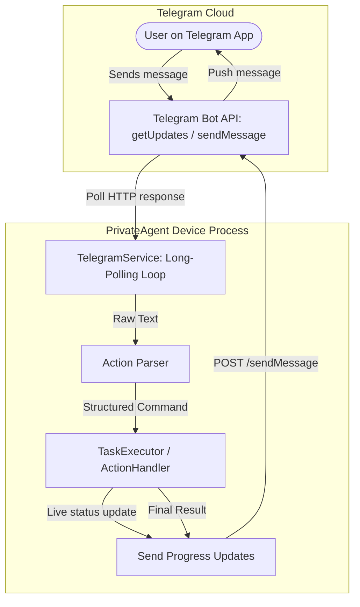
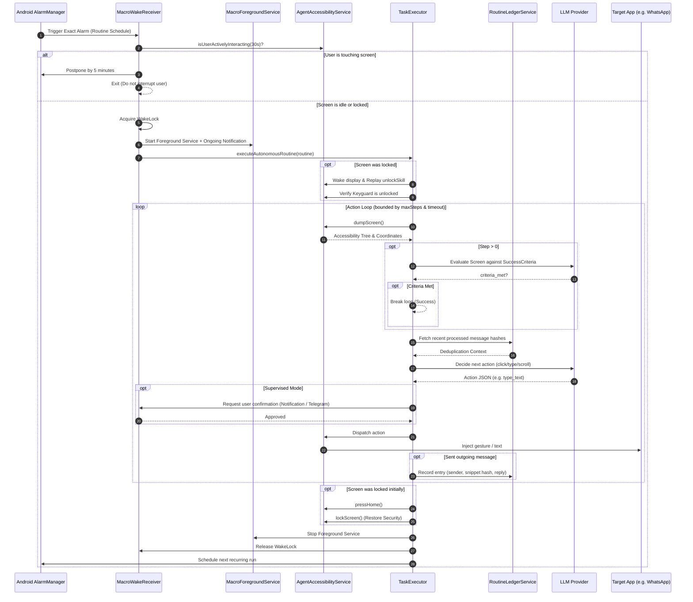

# Architecture & Workflow Diagrams

This document contains visual diagrams mapping out the key processes, architecture, and data flows within PrivateAgent.

---

## 1. High-Level System Architecture



---

## 2. Autonomous Perception-Cognition-Action Feedback Loop



---

## 3. Telegram Remote Control Architecture



---

## 4. Autonomous Routine Background Execution & Screen Lifecycle



---

## 5. CI/CD Release Automation Pipeline

```mermaid
flowchart LR
    Dev([Developer]) -->|Push Git Tag v1.0.3| GH[GitHub Repository]
    
    subgraph GitHub_Actions [GitHub Actions Runner: ubuntu-latest]
        Checkout[Checkout Code]
        SetupEnv[Setup Java 17 + Flutter Stable]
        Tests[Run flutter test]
        BuildUniversal[Build Universal APK]
        BuildSplits[Build Split ABI APKs: arm64, armeabi, x86_64]
        Checksums[Generate SHA256SUMS.txt]
        PublishRelease[softprops/action-gh-release@v2]
    end

    GH --> Checkout
    Checkout --> SetupEnv
    SetupEnv --> Tests
    Tests --> BuildUniversal
    BuildUniversal --> BuildSplits
    BuildSplits --> Checksums
    Checksums --> PublishRelease

    subgraph GitHub_Releases [Public Release Page]
        ReleaseAsset[Release v1.0.3 with APKs & SHA256]
    end

    PublishRelease --> ReleaseAsset
```
