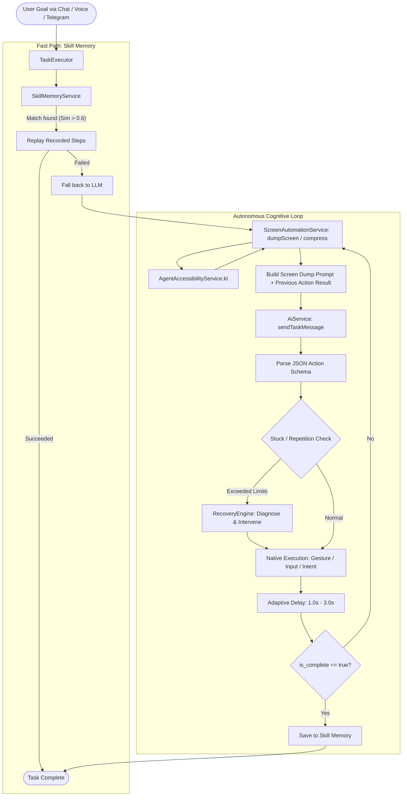

# PrivateAgent: Master Technical Knowledge Base

> **Version:** 1.0.2+2021  
> **Repository:** `nozelrosario/private-ai-agent` (forked from `orailnoor/private-agent`)  
> **Target Platform:** Android 8.0+ (API 26 to API 35+)  
> **Framework:** Flutter (Dart SDK `^3.10.3`) + Native Android Kotlin/Java  

---

## 1. System Overview & Core Philosophy

**PrivateAgent** is an autonomous mobile automation agent for Android. It enables an AI model to perceive what is on an Android smartphone screen, reason about user goals, and execute multi-step physical interactions (taps, text input, scrolling, gestures, app switching, and system settings) via native Android Accessibility APIs and optional ADB/Shizuku access.

### Key Capabilities
1. **Screen Perception & Layout Parsing**: Inspects the active window's `AccessibilityNodeInfo` tree, calculates exact bounding box rectangles and spatial center coordinates, and filters out non-actionable or off-screen noise.
2. **Autonomous Multi-Step Execution Loop**: Continuously feeds compressed UI state into an LLM, receives structured JSON action commands, executes them natively on the phone, and verifies progress.
3. **Skill Memory & Self-Healing (Recovery Engine)**: Stores successful multi-step action sequences locally in JSONL format. Replays them using fast keyword Jaccard similarity without invoking LLM tokens. Detects when the agent is stuck (e.g. keyboard obstruction, loading spinners, missed clicks) and applies automated recovery routines.
4. **Multi-Modal Interaction**:
   - **Text & Voice**: In-app conversational chat UI with speech-to-text (`speech_to_text`) and text-to-speech (`flutter_tts`).
   - **Remote Telegram Access**: Built-in long-polling Telegram Bot integration allowing users to issue instructions to their phone from anywhere.
   - **Floating Overlay** (currently feature-flagged for stabilization): Floating bubble UI overlaying any third-party app.
5. **Provider Agnostic**: Direct compatibility with any OpenAI-compatible API endpoint (DeepSeek, Groq, NVIDIA NIM, OpenRouter, self-hosted Ollama, LM Studio, etc.).

---

## 2. Architecture & Automation Flow



---

## 3. Complete File-by-File Inventory

### 3.1 Root Configuration
- `pubspec.yaml`: Project metadata, dependencies (`http`, `speech_to_text`, `flutter_tts`, `installed_apps`, `url_launcher`, `android_intent_plus`, `flutter_contacts`, `permission_handler`, `shared_preferences`, `flutter_local_notifications`, `volume_controller`, `screen_brightness`, `shizuku_api`, `flutter_overlay_window`), dependency override for local `./local_plugins/flutter_overlay_window`.
- `analysis_options.yaml`: Standard Flutter linting configuration (`package:flutter_lints/flutter.yaml`).
- `devtools_options.yaml`: Flutter DevTools configuration.
- `test_parse.dart`: Standalone utility test script for verifying JSON parsing resilience when LLM responses omit closing brackets.

### 3.2 Application Entry Points & Config (`lib/`)
- `lib/main.dart`: Standard Flutter entry point (`main()`). Initializes bindings, loads saved theme (light/dark mode via `ValueNotifier<ThemeMode>`), checks onboarding status (`onboarding_completed`), registers background overlay listeners, and launches `PrivateAgentApp`. Also declares `@pragma("vm:entry-point") void overlayMain()` for background isolate execution.
- `lib/overlay_main.dart`: Complete standalone Flutter widget tree executed inside the Android overlay window isolate. Contains speech recognition, message list, input bar, and dedicated `TaskExecutor` instance for in-overlay execution.
- `lib/config/feature_flags.dart`: Contains static compile-time feature toggles. Currently holds `static const bool floatingOverlayEnabled = false;` (overlay temporarily disabled pending window stabilization).

### 3.3 Data Models (`lib/models/`)
- `lib/models/agent_action.dart`:
  - `AgentAction`: Represents an LLM-directed operation with `action` (e.g. `open_app`, `make_call`, `execute_task`), parameter map `params`, and natural-language user feedback `response`.
  - Defines `availableActions` catalog.
- `lib/models/chat_message.dart`:
  - `ChatMessage`: Role (`user` or `assistant`), text content, timestamp, and optional `AgentActionResult`.
  - `AgentActionResult`: Execution outcome metadata (`actionType`, `success` boolean, and execution output `details`).
- `lib/models/saved_skill.dart`:
  - `ActionStep`: Single recorded unit of interaction (`action` name + `params`).
  - `SavedSkill`: Recorded macro sequence with task description, keyword list, `successCount`, `failCount`, `lastUsed`, and `steps`. Provides `isReliable` getter (`successCount >= 1 && failure_rate < 30%`).

### 3.4 Core Services (`lib/services/`)
- `lib/services/ai_service.dart`:
  - Manages HTTP communication with OpenAI-compatible chat completion APIs (`/chat/completions`).
  - Supports streaming via `sendMessageStream()` and atomic execution requests via `sendTaskMessage()`.
  - Includes specialized logic for NVIDIA NIM catalog models (defaulting to `z-ai/glm-5.2` with expanded 4096-token budget).
  - Automatically strips reasoning `<think>...</think>` tags generated by reasoning models (DeepSeek R1, GLM, etc.).
  - Handles JSON extraction and repair when LLMs generate slightly malformed or markdown-fenced responses.
- `lib/services/screen_automation_service.dart`:
  - Dart-to-native bridge communicating over `MethodChannel('com.privateagent/accessibility')`.
  - Methods: `isServiceRunning()`, `openAccessibilitySettings()`, `dumpScreen()`, `takeScreenshot()`, `clickByText()`, `clickAt()`, `typeText()`, `pressEnter()`, `scroll()`, `swipe()`, `pressBack()`, `pressHome()`, `openNotifications()`, `getCurrentPackage()`.
  - Includes `getCompressedScreenDescription(task)`: High-efficiency compressor that filters out system bar noise (battery, time, status bars) and tags interactive nodes (`[text]`, `[btn]`, `[toggle]`, `[input]`, `[scroll]`) with coordinate centers to minimize token usage.
- `lib/services/task_executor.dart`:
  - The brain of autonomous operations. Implements the multi-step perception-cognition-action loop.
  - Implements navigation shortcuts (`_getNavigationShortcut`) for direct pre-launch of common destinations (Settings, YouTube, Play Store, WhatsApp, etc.).
  - Incorporates adaptive delays (e.g., 3s for cold-starting apps, 2s after typing, 1.5s after clicking, 1s after scrolling).
  - Employs loop detection: blocks repeated submit actions (`press_enter > 2`) and runaway scrolls (`scroll/swipe > 3`).
  - Features immediate task cancellation via `cancel()` and `_cancelCompleter`.
  - On task completion, persists skills to `SkillMemoryService` and writes execution trace to `TaskHistoryLogger`.
- `lib/services/action_handler.dart`:
  - Central dispatcher executing single-step actions (`open_app`, `make_call`, `send_sms`, `search_contact`, `set_alarm`, `set_volume`, `set_brightness`, `run_adb_command`, `send_email`, `open_url`) as well as delegating `execute_task` to `TaskExecutor`.
- `lib/services/recovery_engine.dart`:
  - Evaluates screen dumps and failure states to autonomously recover when an action fails:
    - Loading/spinner detected -> `wait`
    - Soft keyboard obscuring targets -> `press_back` to dismiss keyboard
    - Click failed on scrollable view -> `scroll` down
    - App failed to launch -> `press_home` and restart
- `lib/services/skill_memory_service.dart`:
  - Persists learned macro routines to `skills_memory.jsonl`.
  - Uses tokenized stop-word removal and Jaccard similarity matching to determine if a new user prompt matches an existing reliable skill.
- `lib/services/task_history_logger.dart`:
  - Appends execution records (`goal`, `status`, `total_tokens`, `steps_taken`, `trace`, `timestamp`) to `task_history.jsonl`.
  - Provides query functions and aggregated analytics (success rate, total runs).
- `lib/services/telegram_service.dart`:
  - Long-polling client communicating with `api.telegram.org/bot<token>/getUpdates`.
  - Receives remote text commands, forwards them through `AiService` and `ActionHandler`, and streams progress updates and completion reports back to the Telegram chat.
- `lib/services/voice_service.dart`:
  - Wraps `speech_to_text` and `flutter_tts` for bidirectional voice conversations.
- `lib/services/app_launcher_service.dart`:
  - Queries all installed user and system apps (`installed_apps`), performs fuzzy name matching, and launches intent packages.
- `lib/services/contacts_service.dart`:
  - Reads Android device contacts (`flutter_contacts`) for phone dialing and SMS addressing.
- `lib/services/communication_service.dart`:
  - Generates `tel:`, `sms:`, and `mailto:` intents using `url_launcher`.
- `lib/services/alarm_service.dart`:
  - Fires native Android alarm and timer intents (`android.intent.action.SET_ALARM`, `android.intent.action.SET_TIMER`).
- `lib/services/system_control_service.dart`:
  - Directly sets media volume (`volume_controller`) and screen brightness (`screen_brightness`).
- `lib/services/notification_service.dart`:
  - Configures high-priority notification channels (`flutter_local_notifications`) to alert users when background tasks complete, cancel, or encounter errors.
- `lib/services/shizuku_service.dart`:
  - Communicates with the Shizuku API (`shizuku_api`) for elevated ADB shell command execution (e.g., `input keyevent`, `input swipe`, `svc wifi`, `cmd bluetooth_manager`, `pm clear`).
- `lib/services/chat_history_service.dart`:
  - Manages chat session files (`chat_history_sessions.json`) and handles file-based atomic message handoff between the background overlay isolate and foreground UI.

### 3.5 UI Screens & Widgets (`lib/screens/` & `lib/widgets/`)
- `lib/screens/home_screen.dart`: Primary UI featuring dual modes (Chat mode vs Agent mode), message stream rendering, voice dictation toggle, drawer navigation for past chat sessions, and settings access.
- `lib/screens/onboarding_screen.dart`: Multi-step setup wizard guiding new users through feature introduction, critical permission requests (Accessibility, Microphone, Notifications, Contacts, Phone, SMS), and AI provider configuration with live connection testing.
- `lib/screens/settings_screen.dart`: Configuration hub for API credentials, base URLs, model selection with live provider `/models` querying, max step limits, temperature, screen compression toggles, Telegram bot configuration, and permission status checks.
- `lib/screens/task_history_screen.dart`: Visual log viewer showing success rates, token metrics, execution steps, and full step-by-step diagnostic traces.
- `lib/widgets/message_bubble.dart`: Styled message bubbles with Markdown rendering (`flutter_markdown`), status chips, and timestamp indicators.

### 3.6 Android Native Implementation (`android/`)
- `android/app/src/main/kotlin/com/orailnoor/privateagent/AgentAccessibilityService.kt`:
  - Core accessibility engine extending Android's `AccessibilityService`.
  - `dumpScreen()`: Recursively walks `AccessibilityWindowInfo` and `AccessibilityNodeInfo` hierarchy. Captures text, descriptions, class types, interactive capabilities, and screen boundary rectangles (`Rect`).
  - `clickByText()`: Searches for exact or contains text matches in interactive views (prioritizing clickable elements over editables).
  - `clickAtCoordinates(x, y)`: Employs `GestureDescription` with 100ms path strokes to perform coordinate-based physical screen clicks.
  - `typeText(text, hint)`: Finds editable nodes and performs `ACTION_SET_TEXT`.
  - `pressEnter()`: Submits IME actions via `ACTION_IME_ENTER`, keyboard action search, or fallback tap within the IME window.
  - `scroll()` & `swipe()`: Dispatches gesture strokes across coordinates or executes `ACTION_SCROLL_FORWARD` / `ACTION_SCROLL_BACKWARD`.
  - `takeScreenshot()`: High-speed hardware buffer screenshot capture (Android 11+ / API 30+).
- `android/app/src/main/kotlin/com/orailnoor/privateagent/MainActivity.kt`:
  - Registers the Flutter `MethodChannel("com.privateagent/accessibility")` and `EventChannel("com.privateagent/accessibility_events")`.
  - Contains `BackgroundEngineReceiver` broadcast receiver (`REGISTER_BACKGROUND_CHANNELS`) to link background Flutter engines (e.g. overlay window) to the accessibility service channels.
- `android/app/src/main/AndroidManifest.xml`:
  - Declares necessary Android permissions (`INTERNET`, `RECORD_AUDIO`, `READ_CONTACTS`, `CALL_PHONE`, `SEND_SMS`, `SET_ALARM`, `WRITE_SETTINGS`, `POST_NOTIFICATIONS`, `QUERY_ALL_PACKAGES`, `FOREGROUND_SERVICE`).
  - Registers `AgentAccessibilityService` with `android.permission.BIND_ACCESSIBILITY_SERVICE`.
  - Includes Shizuku content provider (`rikka.shizuku.ShizukuProvider`).
- `android/app/src/main/res/xml/accessibility_service_config.xml`:
  - Declares accessibility flags (`flagDefault`, `flagRetrieveInteractiveWindows`, `flagIncludeNotImportantViews`, `flagReportViewIds`) and feedback type `feedbackGeneric`.
- `android/app/build.gradle.kts`:
  - Package ID: `com.orailnoor.privateagent`.
  - Java 17 target compatibility with desugaring (`desugar_jdk_libs:2.1.4`).
  - `minSdk = 26`, `targetSdk = 34+`. Release build currently signs with `signingConfigs.getByName("debug")`.

### 3.7 Local Plugins (`local_plugins/`)
- `local_plugins/flutter_overlay_window/`: Custom vendored version of the overlay window plugin enabling floating UI windows over other apps with bi-directional platform channels.
- `local_plugins/agent_native/`: Standalone plugin scaffold (unused in production).

---

## 4. Subsystems Deep-Dive

### 4.1 Accessibility Hierarchy & Coordinate Geometry
Standard screen scrapers struggle with mobile interfaces because many buttons lack text descriptions (e.g., icons, custom views). PrivateAgent solves this using a two-pronged strategy:
1. **Element Bounds Geometry**: When inspecting nodes, `node.getBoundsInScreen(rect)` calculates the exact display coordinates `[left, top, right, bottom]` and the center point `(centerX, centerY)`.
2. **Gesture Simulation**: When `click_at` is invoked, `AgentAccessibilityService.kt` builds a `GestureDescription` with a path located at the calculated coordinates and dispatches it through the accessibility framework. This triggers the click at the OS level, even if the view itself is not marked as clickable.

### 4.2 LLM Action Grammar
The LLM is strictly instructed to return single JSON payloads adhering to this schema:
```json
{
  "action": "click_text | click_at | type_text | press_enter | scroll | swipe | press_back | press_home | open_app | wait | done",
  "params": { ... },
  "reasoning": "brief justification",
  "is_complete": false
}
```
When `AiService` parses the response, it:
1. Strips `<think>...</think>` tags emitted by reasoning models.
2. Extracts JSON if enclosed in markdown code fences (` ```json `).
3. If an LLM response is cut short or missing a closing brace, `AiService` automatically attempts single and double brace closing repairs before failing.

### 4.3 Skill Memory Architecture
Located in `SkillMemoryService`:
- Whenever a multi-step task succeeds, the exact sequence of `ActionStep`s is stored in `skills_memory.jsonl`.
- Future requests tokenize the user input, filter out common English stop words (`to`, `and`, `the`, `a`, `open`, etc.), and calculate the **Jaccard similarity coefficient**:
  $$J(A, B) = \frac{|A \cap B|}{|A \cup B|}$$
- If similarity is $> 0.6$ and the skill has proven reliable ($< 30\%$ failure rate), PrivateAgent runs the recorded macro directly. This provides near-instant execution and zero API token cost.

---

## 5. File System & Storage Locations

On Android, application data is stored in the app's internal storage sandbox (`/data/user/0/com.orailnoor.privateagent/app_flutter/`):
- `task_history.jsonl`: Execution traces, token usage, timestamps, and success metrics.
- `skills_memory.jsonl`: Saved macro action sequences for fast replay.
- `chat_history_sessions.json`: Saved conversational sessions.
- `overlay_chat_handoff/`: Microsecond-timestamped JSON message packets passed between the overlay isolate and foreground process.
- `shared_preferences`: Stores API keys, base URLs, selected model names, Telegram bot token, theme preferences, and feature toggles.
